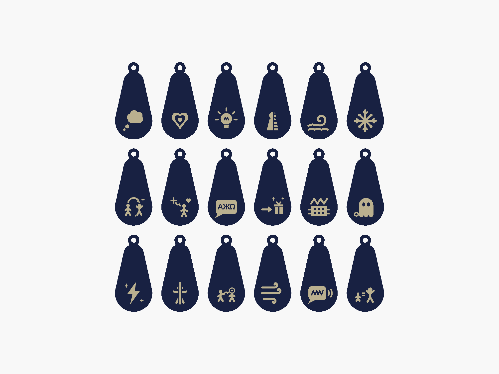

# Mission Sophie : les Pouvoirs volés

Un jeu d'anniversaire pour **7 à 10 enfants de 9-10 ans** (environ 1 h 30), inspiré de la série
*Gardiens des cités perdues*. Les Invisibles ont volé les talents des Gardiennes : grâce à leurs
**pendentifs NFC** imprimés en 3D, les joueuses aident Sophie à les récupérer, épreuve après épreuve,
avec un téléphone Android, « le Transmetteur de Sophie », recopié sur la télé.

> Projet de fans, non officiel et sans lien avec l'autrice ni l'éditeur de la série. Voix, portrait et vidéo de Sophie générés par IA.

## Contenu du dépôt

| Dossier / fichier | Contenu |
|---|---|
| [`documents/`](documents) | **La notice du jeu** (Word + PDF) : déroulé minute par minute, textes, fiche du maître du jeu, préparation, imprimables, liste des voix. |
| [`cartes-a-imprimer.pdf`](cartes-a-imprimer.pdf) | Cartes de personnage et cartes-souvenirs en couleur, recto-verso (source : `cartes-couleur/cartes.html`). |
| [`app/`](app) | L'application Android (Kotlin, Jetpack Compose), 100 % hors ligne. Notice technique : [`app/README.md`](app/README.md). |
| [`amulettes-mission-sophie.scad`](amulettes-mission-sophie.scad) | Modèle OpenSCAD des pendentifs : 18 symboles de talents, 2 faux badges (le piège) et le Cœur de Sophie (étoile). |
| [`stl-amulettes/`](stl-amulettes) | STL prêts à imprimer : `<talent>-base.stl` (couleur 1), `<talent>-symbol.stl` (couleur 2), `couvercle.stl`. |
| [`roue-elfique.scad`](roue-elfique.scad), [`stl-roue-elfique/`](stl-roue-elfique) | Roue de chiffrement elfique (épreuve de la Polyglotte), lettres seules ou lettres + chiffres (`chiffres/`). |
| `cartes-personnages-svg/`, `cartes-souvenirs-svg/` | Cartes en SVG, pour les modifier. |
| [`voix/`](voix) | Liste des 209 répliques à enregistrer (CSV et JSON). |
| [`apercus/`](apercus) | Aperçus des pièces et des cartes. |

## Ce qu'il faut

- Un **téléphone Android avec NFC** (Android 8 ou plus ; testé sur OnePlus 7 Pro), idéalement recopié sur une télé.
- Des **tags NFC « goutte » porte-clés** (27 × 54 mm, 1,1 mm d'épaisseur) : un par pendentif, plus le faux badge et le Cœur de Sophie.
- Une imprimante 3D (2 couleurs, ou changement de filament), une imprimante couleur recto-verso, une plastifieuse (conseillé).
- Le détail complet (cachettes, objets, accessoires) est dans `documents/preparation-mission-sophie.pdf`.

## Mise en route

1. **Lire** `documents/deroule-mission-sophie.pdf` puis `documents/fiche-mj-mission-sophie.pdf`.
2. **Imprimer les pendentifs** (voir plus bas), y glisser les tags.
3. **Imprimer les cartes** : `cartes-a-imprimer.pdf` à 100 %, recto-verso **bord long**, puis plastifier. Les imprimables (indices, message codé…) sont dans `documents/imprimables-mission-sophie.pdf`.
4. **Installer l'appli** : APK disponible dans les *Releases* du dépôt, ou à compiler (`app/README.md`). Autoriser le micro (cri-mètre).
5. **Régler le prénom, l'âge et les lieux** dans l'appli (voir « Personnaliser »).
6. **Lier les tags** : accueil › Admin (PIN `4275`, modifiable) › Liaison : un tag par pendentif, puis le faux badge et le Cœur.
7. **Choisir la météo** (Admin › Réglages › Météo) : les lieux des cachettes changent selon qu'on joue dedans (pluie) ou dehors (beau).
8. Désactiver le **simulateur** (Admin › Réglages › Tests) avant de jouer, et suivre `app/CHECKLIST-JOUR-J.md`.

Pendant la partie, le **menu du maître du jeu** s'ouvre par un appui long de 3 secondes sur le portrait de Sophie, puis le PIN : passer une étape, joker, indice, retour arrière, volumes…

## Personnaliser

**Dans l'appli**, sans rien recompiler : Admin › Réglages › **Personnaliser** :

- **Prénom** et **âge** de l'enfant fêtée (écran d'accueil et message final de Sophie). Tant que le prénom n'est pas réglé, l'accueil le rappelle.
- **Les lieux**, pour chaque météo : d'où vient le faux pouvoir (le piège), la cachette du Cœur de Sophie, la zone surveillée de l'Éclipseur. Écrire le lieu comme il s'insère dans la phrase : « de la mezzanine », « dans la cave », « la cuisine ».
- La **météo** (Admin › Réglages › Météo) choisit la série de lieux : pluie (dedans) ou beau temps (dehors).

Les voix enregistrées ne prononcent ni le prénom ni les lieux : ils restent écrits à l'écran, la voix colle donc à n'importe quel réglage.

**Pour aller plus loin**, tous les textes sont dans [`app/android/src/main/assets/game_content.json`](app/android/src/main/assets/game_content.json) :
`params` (valeurs par défaut du prénom et de l'âge), `variants` (lieux par météo), `{{prenom}}`, `{{age}}` ou `{{nom_du_lieu}}` utilisables dans n'importe quel texte, `sequence` (ordre des épreuves ; seules celles des pendentifs posés au rassemblement sont jouées), les codes des épreuves (à changer avec les indices imprimés).
Le fichier modifié s'importe sans recompiler (Admin › Contenu › Importer). Régénérer ensuite les documents (voir plus bas).

## Voix, images, musique

Inclus dans l'appli (générés par IA) :

- **129 voix** (Sophie et les Invisibles), mp3. La liste complète des 209 répliques est dans `documents/voix-mission-sophie.pdf` : celles qui manquent (consignes, variantes, épreuves bonus…) s'affichent en texte. Pour en ajouter : nommer le fichier comme la colonne « Fichier », puis Admin › Contenu › **Importer un dossier** (« Vérifier les voix » liste ce qui manque) ou le placer dans `app/android/src/main/assets/audio/`. Conversion (coupe des silences, volume égalisé, mp3) : `python tools/convertir_voix.py dossier-wav dossier-mp3` depuis `app/` (ffmpeg requis).
- Le **portrait** (`sophie.jpg`) et la **vidéo** muette de Sophie (`sophie.mp4`), affichée quand elle parle.
- La **musique** : « Fantascape » (version boucle), Eric Matyas, www.soundimage.org ([soundimage.org](https://soundimage.org/fantasywonder/), gratuite avec crédit, affiché dans l'appli).
- Les Invisibles : un œil dessiné par l'appli, remplaçable par `invisibles.png` (ou `.gif` animé).

## Impression 3D

**Pendentifs** (`amulettes-mission-sophie.scad`, OpenSCAD 2021.01 ou plus récent) :

- Mesurer ses tags et ajuster `TAG_L`, `TAG_R_BIG`, `TAG_T` (1,1 mm pour nos tags) avant d'exporter.
- `SHAPE` : `goutte` (épouse le tag, avec boucle), `rond`, ou `etoile` (Cœur de Sophie, sans boucle, avec liseré).
- Par pendentif, exporter `PART = "base"` et `PART = "symbol"`, les charger ensemble dans le trancheur (elles se superposent) et leur donner 2 couleurs. Face avant sur le plateau : le symbole est déjà retourné.
- Glisser le tag dans le logement au dos, puis coller ou clipser le couvercle (`PART = "lid"`).
- Le faux badge (piège) imite un vrai pendentif avec un symbole déformé (`faux_givreur`, `faux_empathe`).

**Roue elfique** (`roue-elfique.scad`) : deux disques qui tournent sur un axe clipsé. Réglages validés à l'essai :
`LEVRE = 0.35`, `FENTE = 1.8`, `PAROI = 1.3` (si le clip est trop dur : baisser `LEVRE`). Imprimer d'abord `roue-test_axe.stl`.
`CHIFFRES = true` donne 36 cases (A–Z puis Ø, 1–9) pour des codes avec chiffres.

## Régénérer les fichiers

Depuis `app/` :

| Commande | Produit |
|---|---|
| `cd tools/docs && npm install && npm run docs` | Les documents Word dans `documents/` (conversion PDF : Word ou LibreOffice). |
| `python tools/gen_cartes_couleur.py` | `cartes-a-imprimer.pdf` (avec Microsoft Edge ; sinon imprimer `cartes-couleur/cartes.html` depuis un navigateur). |
| `python tools/gen_voix.py` | La liste des voix dans `voix/`. |
| `python tools/gen_symbols.py [openscad]` | Les symboles de l'appli depuis le modèle 3D. |
| `python tools/gen_cartes.py`, `python tools/gen_objets.py` | Les cartes en SVG. |

## Crédits

- Jeu, appli et modèles : créés pour un anniversaire en octobre 2026, avec l'aide de Claude (Anthropic).
- Symboles des talents : d'après des dessins d'enfant.
- Musique conseillée : « Fantascape », Eric Matyas, www.soundimage.org.
- Univers : *Gardiens des cités perdues* (*Keeper of the Lost Cities*), Shannon Messenger. Les noms de talents et de personnages appartiennent à leurs ayants droit.
